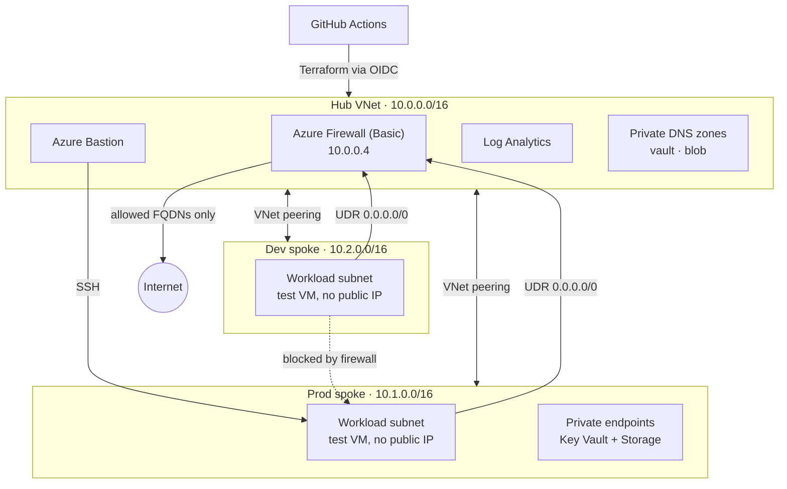

# Azure Hub-and-Spoke Landing Zone


A hub-and-spoke network on Azure, built with modular Terraform and deployed through a GitHub Actions pipeline that authenticates with OIDC (no stored secrets). All spoke traffic is inspected by Azure Firewall, PaaS services are reachable only through private endpoints, and Azure Policy blocks non-compliant deployments.

## Architecture



| Network | Address space | Contents |
|---|---|---|
| Hub | 10.0.0.0/16 | Azure Firewall (Basic), Azure Bastion, Log Analytics, private DNS zones |
| Prod spoke | 10.1.0.0/16 | Workload subnet, private endpoint subnet (Key Vault, Storage) |
| Dev spoke | 10.2.0.0/16 | Workload subnet |

## What this demonstrates

- **Networking:** hub-and-spoke with VNet peering, forced tunnelling through Azure Firewall using UDRs, NSGs, Azure Bastion
- **Private connectivity:** Key Vault and Storage with public network access disabled, private endpoints and centralised private DNS
- **Governance as code:** Azure Policy (allowed locations, required tags, no public IPs on spoke NICs), a custom least-privilege RBAC role, activity log export
- **Infrastructure as code:** modular Terraform, `for_each` spokes, remote state in Azure Storage with Entra ID auth
- **CI/CD:** Checkov security scan and Terraform plan on every pull request, plan posted as a PR comment, approval-gated apply, OIDC workload identity federation
- **Cost control:** feature toggles for expensive resources, budget alerts

## Design decisions

| Decision | Why | In production I would |
|---|---|---|
| Azure Firewall **Basic** SKU | Lowest-cost SKU that supports forced tunnelling for a lab | Use Standard or Premium for IDPS, DNS proxy and autoscaling |
| UDR `0.0.0.0/0` → firewall on spoke subnets | Central inspection of egress and spoke-to-spoke traffic; peering is non-transitive, so spokes can only reach each other via the firewall | Same, plus a VPN or ExpressRoute gateway in the hub |
| Private DNS zones in the hub, linked to every VNet | One place to manage name resolution for all spokes | Same, with Azure DNS Private Resolver for on-premises resolution |
| "No public IPs on NICs" policy scoped to spokes only | The hub legitimately needs public IPs for Firewall and Bastion | Same principle, assigned at management group scope |
| OIDC workload identity federation | No long-lived client secrets to store, leak or rotate | Same |
| Remote state with Entra ID auth, shared keys disabled, blob versioning | Secure, lockable, recoverable state | Same, with separate state per environment |
| Cost toggles (`enable_firewall`, `enable_bastion`, `deploy_test_vms`, `enable_private_endpoints`) | Run expensive resources only while testing | Remove toggles; use reservations and right-sizing |
| Contributor + User Access Administrator for the pipeline identity | Needed to manage policy assignments and the custom role | A custom role limited to the required `Microsoft.Authorization` actions |

## Verification

Each control was tested and evidenced. Screenshots are in [`docs/screenshots`](docs/screenshots).

| Test | Expected result | Evidence |
|---|---|---|
| Egress IP from prod VM (`curl ifconfig.me`) | Firewall's public IP | [02](docs/screenshots/02-vm-proofs.png) |
| Request to a non-allowed site | Blocked by firewall | [02](docs/screenshots/02-vm-proofs.png), [08](docs/screenshots/08-firewall-logs.png) |
| Prod → dev on port 22 | Timed out (spokes isolated) | [02](docs/screenshots/02-vm-proofs.png) |
| Effective routes on prod NIC | `0.0.0.0/0` → virtual appliance `10.0.0.4` | [03](docs/screenshots/03-effective-routes.png) |
| Key Vault DNS from laptop | Public IP, public access disabled | [09](docs/screenshots/09-dns-from-laptop.png), [10](docs/screenshots/10-kv-public-blocked.png) |
| Key Vault DNS from prod VM | Private IP `10.1.2.4`, port 443 reachable | [12](docs/screenshots/12-dns-from-vm.png) |
| Private DNS A record | Created automatically by the endpoint | [11](docs/screenshots/11-private-dns-record.png) |
| VNet in East US | Denied by policy | [13](docs/screenshots/13-policy-deny-location.png) |
| Resource group without `owner` tag | Denied by policy | [14](docs/screenshots/14-policy-deny-tag.png) |
| Pull request | Plan posted as a comment | [22](docs/screenshots/22-pr-plan-with-changes.png) |
| Merge to `main` | Apply waits for approval, then succeeds | [19](docs/screenshots/19-apply-waiting-approval.png), [20](docs/screenshots/20-apply-success.png) |

## CI/CD pipeline

```
Pull request ──► Checkov scan ─┐
             └─► terraform fmt / validate / plan ──► plan posted as PR comment
                                                       │
Merge to main ◄── required status checks pass ◄────────┘
      │
      ▼
Manual approval (production environment) ──► terraform apply
```

- GitHub authenticates to Azure with **OIDC**. Federated credentials trust only this repository's pull requests and its `production` environment.
- `main` is protected: changes require a pull request, and both checks must pass before merging.
- Applies are serialised with a `concurrency` group, and use a saved plan file so the reviewed plan is exactly what gets applied.
- The subscription ID is masked in plan comments because the repository is public.
- Checkov is enforced (`soft_fail: false`): 47 checks pass, and the 7 suppressions are documented inline with a justification for each.

## Cost

| State | Approximate cost |
|---|---|
| Baseline (VNets, peering, NSGs, Log Analytics, policy) | Under £1/month |
| Full test session (Firewall, Bastion, 2 VMs, private endpoints) | About £0.60/hour |

Expensive resources are switched on and off with variables in `infra/terraform.tfvars`, through a pull request.

## Challenges and what I learned

Real problems hit during the build, and how they were solved:

- **VM capacity vs quota:** `Standard_B1s` returned `SkuNotAvailable` (regional capacity), then `Standard_B2ats_v2` failed on a **zero vCPU quota** for its family. Diagnosed with `az vm list-skus` and `az vm list-usage`, then moved to a size with both capacity and quota, and made the VM size a variable.
- **Orphaned resource:** Bastion creation exceeded Terraform's 30-minute timeout. Azure finished building it, but it was never recorded in state, so a later destroy failed on its attached public IP. Resolved by deleting the orphan with the Azure CLI and re-applying (the alternative being `terraform import`).
- **OIDC subject mismatch:** the first pipeline run failed with `AADSTS700213`. Newer GitHub repositories present an immutable subject (`repo:Owner@<id>/repo@<id>:...`); the federated credentials were updated to match.
- **Two locks on Key Vault:** the portal returned an RBAC error before the network restriction was even evaluated, a practical example of defence in depth.

Detailed notes from each stage are in [`docs/LEARNING.md`](docs/LEARNING.md).

## Repository structure

```
.github/workflows/      terraform-plan.yml, terraform-apply.yml
infra/                  root module: backend, providers, variables, main, outputs, tfvars
modules/
  hub-network/          hub VNet, Azure Firewall, Bastion, Log Analytics
  spoke-network/        spoke VNet, NSG, peering, route table, optional test VM
  private-endpoints/    Key Vault, Storage, private endpoints, private DNS zones
  governance/           policy assignments, custom role, activity log export
scripts/
  bootstrap-state.sh    creates the remote state storage account
docs/
  LEARNING.md           build notes
  oidc-setup.md         pipeline identity setup
  screenshots/          verification evidence
```

## Deploy it yourself

1. Run `scripts/bootstrap-state.sh` and put the storage account name in `infra/backend.tf`.
2. Create the pipeline identity and federated credentials: see [`docs/oidc-setup.md`](docs/oidc-setup.md).
3. Add `AZURE_CLIENT_ID`, `AZURE_TENANT_ID` and `AZURE_SUBSCRIPTION_ID` as repository secrets, and create a `production` environment with required reviewers.
4. Open a pull request.

## What I'd add next

- An AKS spoke with egress through the firewall
- Azure DNS Private Resolver and a VPN gateway for hybrid connectivity
- `terraform test` for module tests
- Azure Virtual Desktop as an additional spoke
